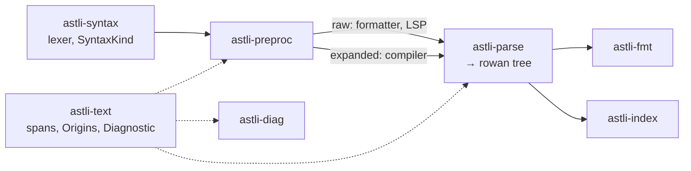

# Project plan

> **Status:** lexer, preprocessor, parser, formatter v0, the crate APIs, file
> selection and pickling, sv-tests, syntactic lint and names in a definition
> done (M1–M9), then elaboration and discovery (M11, M10). M12, M13 and M14
> are open.

## 1. What this is

SystemVerilog language tooling in Rust, built around one lossless syntax tree.
The name is Swiss German *Ästli*, "little branch", which is also an AST, in the
line of Zurich's Zopfli and Brotli. Every library crate is prefixed `astli-`,
`astli` re-exports them all, and the driver is `astli-cli`, whose binary is
`astli`.

Existing options are unsatisfying: `verible-verilog-format`'s output is not
what I want, `slang` is excellent but C++ and not built for formatting, and the
Rust attempts (`sv-parser`, `moore`, `svls`) are slow, abandoned, or not
lossless.

### Objectives, in priority order

1. **A formatter I actually want to use**, correct on `` `ifdef ``-heavy,
   UVM-macro-heavy code and not only on textbook RTL.
2. **A reusable lossless syntax layer** for a linter, an LSP, refactoring.
3. **A standalone preprocessor crate.** The Rust ecosystem has nothing good.
4. **Semantic analysis** for `astli lint` and `astli check`: name
   resolution, constants, types, elaboration ([`sema.md`](sema.md)).
5. **A design found, not listed:** `astli` run without a filelist, and in
   time dependencies resolved as Cargo does ([`packages.md`](packages.md)).
6. **A design built and run:** `astli build` and `astli run` drive a
   simulator as Cargo drives `rustc`, keeping what it compiled
   ([`build.md`](build.md)).

### Non-goals

- Simulating, synthesising, writing netlists: `build` drives a simulator,
  it is not one.
- Replacing `slang` as a compiler.
- Full Annex A coverage before shipping; see [D3](#4-decisions).
- A separate Verilog-95/2001 mode.

`slang` is the reference to consult when a design question has a non-obvious
answer. Understand its choices; don't transliterate them or reuse its type
names.

## 2. Architecture

| Crate | Holds |
| --- | --- |
| `astli-text` | Source ids, spans, the buffer store (`Origins`) and its origin map, `Diagnostic`. No dependencies. |
| `astli-syntax` | `SyntaxKind` (tokens *and* nodes, one enum), the `logos` lexer, keywords, the `rowan` `Language` impl, and `ast`: typed views generated from `astli.ungram`. |
| `astli-preproc` | Directives, the macro table, expansion, includes, conditionals. Both output modes. No grammar. |
| `astli-parse` | The event-based parser, the tree builder, `SyntaxTree`. |
| `astli-diag` | Rendering a diagnostic with its expansion and include chain (`ariadne`). |
| `astli-fmt` | `format`, and the transparency check that guards it. |
| `astli-index` | What each file declares and uses at the top level (`Summary`), and those names resolved across files (`Index`). |
| `astli-sema` | The HIR one file's tree lowers to, and the analyses over it ([`sema.md`](sema.md)). |
| `astli-lint` | Lint rules over one raw tree, their groups and levels ([`sema.md`](sema.md)). |
| `astli-package` | A package's root and its `astli.toml`, read whole: `[package]` interpreted, `[fmt]` and `[lint]` handed to the driver ([`packages.md`](packages.md)). |
| `astli-resolve` | Dependencies fetched with `gix` into a cache every design shares, a mirror per repository and a checkout per commit, and their versions chosen with PubGrub ([`packages.md`](packages.md)). |
| `astli-cli` | The driver: one subcommand per stage (`lex`, `preprocess`, `parse`, `fmt`, `lint`, `check`), `files`, filelists, parallelism, rendering. |

What each crate *exposes* is in [`api.md`](api.md). Corpus-wide research tools
(`metrics`, `verbatim-report`, `conditionals`, `unformatted`) stay examples. The rule is that a
per-file dump belongs to the driver and a question about the corpus stays an
example.

**Two token streams, one grammar.** Raw mode keeps directives, macro calls and
every conditional branch as structure and follows no include. The formatter and
the LSP's in-buffer requests read it. Expanded mode expands macros, follows
includes and evaluates conditionals, with per-token provenance. The parser is
generic over the stream and does not know which one it has. An expanded tree
spans every file its expansion read ([D19](#4-decisions)).
[`preprocessor.md`](preprocessor.md) has the design.

**Trivia.** Whitespace and comments are tokens in the tree, placed by the
builder: leading trivia goes to what follows, and a same-line comment stays
with the token before it. The formatter plans its own comment placement on top
of that ([`formatter.md`](formatter.md#design)).

**Diagnostics.** `Diagnostic` lives in `astli-text` so that every producer can
construct one without a new dependency edge. Its `Span` says which expansion
placed the token, so a message about a macro-produced token can point at the
call the user wrote. The expansion chain is derived at render time. The message
is a pre-rendered `String` and the code a `&'static str` newtype, because
`astli-text` cannot see `SyntaxKind`. Each producing crate keeps one
`diagnostics.rs` catalogue. The lexer reports nothing: `LEX_ERROR` tokens in
the tree are the record. Parser diagnostics sit beside the events and are
truncated by rollback, so almost everything a speculative rule could say is
withdrawn; what survives is a run left unclosed at end of file. What the
parser kept as `VERBATIM` is read off the finished tree instead: in raw mode
as a `not-parsed` warning that `parse` prints and `fmt` does not, since there
it is often the right result; in expanded mode as an error among the parse's
own, at its first token, which `check` reports ([D22](#4-decisions)). Only
expanded mode reports undefined macros, since in raw mode they are the normal
case.
Rendering uses `ariadne` with `IndexType::Byte`: its default counts characters,
and one multi-byte character puts every later caret on the wrong line.

**Parallelism** is one file per `rayon` task, in the driver ([D13](#4-decisions)).
Output stays in the order files were named, so runs can be diffed. Measured
4.9x on 8+2 cores over 3000 files.

## 3. Formatter model

- **Trivia is placed, never skipped.**
- **Separation is requested, not written.** Rules request a minimum
  separation, resolved when the next token is written. This gives no trailing
  whitespace and indentation without call sites.
- **Whitespace is discarded, its signal kept.** Blank lines become a gap
  width.
- **Line breaking** uses a Wadler-style document IR; **alignment** is a
  post-pass ([D4](#4-decisions)).
- **Preprocessor transparency is an assertion inside `format`**, not only a
  test ([D5](#4-decisions)).

## 4. Decisions

| # | Decision | Why |
| --- | --- | --- |
| D1 | `logos` for lexing, `rowan` for the tree | `rowan` is the Roslyn lossless-tree model. Lexer modes only where one earns itself; `` `define `` bodies turned out to need one rule, not a mode. |
| D2 | Hand-written recursive descent, event-based, with snapshot and rollback | SV is not LL(k): `foo bar;` and `(a)(b)` need lookahead or backtracking. A formatter must give bytes back on a wrong guess, which is undo, which checkpoints cannot do. |
| D3 | **Verbatim fallback from day one** | An unparsed construct becomes a byte-exact, balanced `VERBATIM` node at an item, member or statement boundary, so a useful formatter ships at partial grammar coverage. |
| D4 | Column alignment is a post-pass over emitted lines | lowRISC requires aligned connections and encourages aligned declarations. Runs of same-shaped siblings align. A blank line ends a run and a comment line does not: one annotates a group, the other ends it. A long trailing comment gives up its column first. A row whose other columns would take it past the width splits the run: the rows on either side, and a run of rows that do not fit, align among themselves, so no table has holes. Precedent: gofmt's `tabwriter`. |
| D5 | Formatter is preprocessor-transparent, asserted | [`preprocessor.md`](preprocessor.md#the-transparency-invariant). |
| D6 | Formatter never follows `` `include `` | Each file is formatted alone. |
| D7 | Few knobs: indent (2), width (100), `max-pad` (12), in `astli.toml` only | Opinionated is cheaper and what people want. No flag or variable per knob, so every run in a project formats the same. |
| D8 | MIT OR Apache-2.0 | Rust norm. |
| D9 | Provenance per token, not per byte, carried by the span | Tokens are emitted, not text, so a macro argument token keeps its own call-site span. No role-swapping flag. A text `-E` mode would need its own path. A buffer seen through an expansion gets its own `SourceId`, so a `Span` keeps the buffer's offsets and needs no second location type. |
| D10 | Line table built eagerly when a buffer is added | One vectorisable pass, 4 bytes per line, far cheaper than lexing. A lexer-callback table would put `astli-text` under the lexer and make `line_col` partial. |
| D11 | Node kinds are hand-authored, not Annex A's productions | 122 of 747 productions are pure aliases and 80 are `*_identifier`; the expression grammar does not survive the trip. Generating from it leaves ~660 kinds nothing builds and kills the formatter's exhaustiveness check. |
| D12 | The crate split runs from the parser end | `logos` derives on `SyntaxKind`, which holds node kinds too, so a lexer-only crate would carry them anyway. |
| D13 | Parallelism is per file, in the driver | Nothing inside a file is worth splitting (the largest lexes in 5 ms). Sessions and `SyntaxNode` are `!Send`, so workers return rendered bytes. |
| D14 | `usage` for the CLI, not `clap` | The same declarations produce completions and docs. Commands stay plain functions, so it is cheap to replace. |
| D15 | Formatter output is a function of the file's bytes | No include path, `+define+` or filelist reaches `fmt`, not even to learn macro arities; otherwise editor and CI disagree. Definitions in the file itself still count. |
| D16 | Typed views are generated from a hand-written tree grammar, `astli.ungram` | It describes the tree, not Annex A, so D11 stands. The generated code is checked in, and a test fails when it is stale. Where two children could be of one type, only position tells them apart, and those accessors are written by hand. The corpus is held to the grammar's node shapes, which catches wrong nesting that a round-trip cannot; that gate reads the grammar, not the views. The views wait for a reader such as a linter or an LSP. The formatter does not use them: a rule must write every token once and in order, so it matches a node's children exhaustively, which proves nothing else is there, where an accessor only finds its child. |
| D17 | Each file is its own compilation unit. One unit over all files would come only from a filelist, under a flag, never inferred nor set in a package's manifest, and waits for a design that needs it | The standard requires both. Separate units need no file order and parse in parallel; one unit is what older flows expect, a defines file listed first. In one unit the order changes what the files mean, and only a filelist states it: files can be ordered by what they declare, as every such order means the same, but not by their defines, where two definitions of a macro or an `` `ifndef `` fallback make each order another design. One unit invites code that relies on its order, so a package never gets it. Only expanded mode can tell them apart. |
| D18 | Three versions: the libraries the umbrella re-exports share one, measured by their API; `astli-cli` has its own, measured by what its users see, and owns the changelog and the `vX.Y.Z` tag; `astli-package` and `astli-resolve` each have their own and promise no API. The bare name is the umbrella | Each library exposes the types of those below it, so a break low down breaks everything above, and versions of their own would let release-plz ship that as a patch; sharing one costs an unchanged library a new number and nothing else. The command promises something else, its flags, output and files, so a library's API break is no break of it, and a fix to it needs no new library minor. The two crates that serve only the driver follow what it needs, and no one else should depend on them. A `!` marks a break of the command alone, since release-plz counts every commit in the command's changelog toward its version; a library's API break is found by cargo-semver-checks. The libraries are the point, so they get `astli`, and the binary lives in `astli-cli`. |
| D19 | An expanded tree's text is `render`'s: each token's spelling, with a space or newline added where two would paste; `Parsed::span` maps a token back to its placed `Span` | A tree over many buffers has no file to index, and rowan tokens hold only text. Text that lexes back to the same tokens can be printed as it is, which is what pickling writes. A table from offset to span costs 16 bytes a token. |
| D20 | Expansion keeps each directive that means something after preprocessing, its tokens as trivia and the macros in its operands expanded: all but conditionals, `` `define ``, `` `undef ``, `` `undefineall ``, an `` `include `` it followed, and `` `__FILE__ ``/`` `__LINE__ `` | Dropping them loses a `` `timescale `` or `` `default_nettype `` from pickled or preprocessed output. An `` `include `` not found marks where text is missing, which sema must not assume away. As trivia they reach `render` and the expanded tree, and no reader of either needs to change. |
| D21 | An encrypted envelope, `` `pragma protect begin_protected `` through `end_protected`, expands to trivia whole; `Summary::encrypted` flags the file, and `reachable` keeps it and what it needs whatever the tops | Ciphertext is neither code nor macros, and has to be written back byte for byte, which trivia is. What it declares is hidden, so it is kept, as bender keeps one by default. |
| D22 | The fallback is raw mode's: there it keeps what only expansion could parse, a conditional that splits a construct or a macro standing for syntax, and what no compiler would take either. In expanded mode a construct the grammar cannot read is an error, `not-parsed`, at its first token | A raw file is every configuration at once, and the formatter must take each file a compiler takes in one of them ([D3](#4-decisions)). An expanded stream is what a compiler reads, so there the grammar may reject only what a compiler rejects. |

## 5. Milestones

Milestones are independent unless one names another it needs, so several
may be open at once and they need not close in order. Open work is tracked
as a [GitHub milestone](https://github.com/fischeti/astli/milestones) with an
issue per step, which is where their state lives; this list says what each
one is for, and where the design it produced is written down.

- **M0 — Scaffolding.** *Done.* Workspace, `prek` hooks, CI.
- **M1 — Lexer.** *Done.* Gapless round-trip over the corpus, and kind
  audits, since round-trip alone proves nothing about kinds.
- **M2 — Preprocessor.** *Done.* Agrees with `slang -E` over the corpus
  ([`preprocessor.md`](preprocessor.md#the-oracle)).
- **M3 — Parser + RTL subset.** *Done.*
  ([`grammar-coverage.md`](grammar-coverage.md)).
- **M4 — Formatter v0.** *Done.* Idempotent and transparent over the
  corpus ([`formatter.md`](formatter.md)).
- **M5 — Crate APIs.** *Done.* Revisited with the formatter as their first
  caller ([`api.md`](api.md)).
- **M6 — File selection and pickling.** *Done.* `astli files` and
  `astli pickle`, the first readers of expanded mode and of names across
  files (below).
- **M7 — sv-tests.** *Done.* Scored by `scripts/sv-tests.py`.
- **M8 — Syntactic lint.** *Done.* `astli lint` over one raw file
  ([`sema.md`](sema.md)).
- **M9 — Names in a definition.** *Done.* `astli-sema`'s HIR and name
  resolution, `astli check`, and the lint rules that read a design
  ([`sema.md`](sema.md)).
- **M11 — Elaboration.** *Done*, before M10, which it does not need.
  Values, constants, types and the instance tree from `--top`; `astli elab`
  ([`sema.md`](sema.md)).
- **M10 — Discovery.** *Done.* Commands with no arguments read the package
  the current directory is in ([`packages.md`](packages.md#phases)).
- **M12 — Language server.** `astli lsp` over the package the open file is
  in: diagnostics, formatting, outline, definition, references, hover,
  rename and completion, kept current as buffers change. In-buffer requests
  read the raw tree, semantic ones the expanded tree
  ([`preprocessor.md`](preprocessor.md)).
- **M13 — Package manager.** astli fetches and selects a design's
  dependencies itself, as bender does: dev sources, features and overrides,
  path and git dependencies with versions, a lockfile, a shared store, and
  generators ([`packages.md`](packages.md#phases), phases 2–4).
- **M14 — Conformance.** What astli does not understand is an error rather
  than silence, where a compiler would reject it too: an expanded tree has
  no `VERBATIM`, sema lowers what it leaves opaque, and every sv-tests test
  is scored, elaboration included. Raw mode keeps the fallback where the
  formatter needs it.
- **M15 — Terminal output.** *Done.* One look for everything the driver
  writes to stderr ([`cli.md`](cli.md)).
- **M16 — Performance and structure.** astli uses the machine it runs on:
  no walk quadratic in a tree's depth, no file read or lexed twice where
  once would do, no thread held idle, and no slow build script. Where two
  crates model the same thing, one does. Measured on opentitan and a clean
  workspace build, before and after each change.
- **M17 — Build and run.** `astli build`, `astli run` and `astli clean`
  with Verilator, leaving room for simulators that compile packages into
  libraries ([`build.md`](build.md)).

### M6: `astli files` and `astli pickle`

Replaces `bender-slang`, the C++ bridge behind `bender script --top` and
`bender pickle`. Its design follows what slang's metadata offered; this one
need not. astli does the selection itself rather than bender calling it per
source group: the package model reads none of bender's file model
([P14](packages.md#decisions)).

- **Expanded, not raw.** Raw mode misses a module instantiated by a macro from
  a header, which drops a needed file, and keeps every conditional branch,
  which keeps extra ones.
- **Names.** Declared: `MODULE_DECL`, `INTERFACE_DECL`, `PROGRAM_DECL`,
  `PACKAGE_DECL`, `CLASS_DECL` at the top level. Referenced: an
  instantiation's type, an import's package, the name left of `::`, the head
  of a `TYPE_REF` (interface ports, virtual interfaces, class types,
  `extends`), a `bind`'s target; a file binding at its top level is kept
  with its target's. Closing: an end label, `endmodule : top`,
  renamed with its declaration. A top-level `VERBATIM` is scanned by token
  for declarations and end labels, since a rule giving up inside a module
  leaves all of it unparsed, and any `VERBATIM` for `IDENT [#(…)] IDENT (`.
- **Problems are warnings:** an instantiation or import of a name no file
  declares, or a name declared twice that nothing uses. One declared twice
  and used, or named as a top, is an error ([P7](packages.md#decisions)). A
  file is kept or dropped whole, as in `bender`.
- **Tops are named, never inferred.** `--emit tops` lists names nothing
  references, but many of those do not compile alone, and a compiler handed
  them all reports thousands of errors.
- **Encrypted files** are kept whatever the tops, with what their plaintext
  needs ([D21](#4-decisions)). A name used inside an envelope cannot be
  renamed, so `pickle` warns when renaming with one kept.
- **Each file is its own unit** ([D17](#4-decisions)), as in slang.
- **No pickle crate.** An expanded tree's text is `render`'s
  ([D19](#4-decisions)), so pickling is writing tree tokens with some
  replaced: the renaming lives in `astli-index`, and the few lines that select
  and write files in the CLI. A general rewriter
  waits for a second user; an LSP rename or a lint fix edits source text by
  span, which is a different shape.
- **Only `--expand` renames**, as `bender pickle` renames only with
  `--expand-macros`. A name a macro writes has no site to rename outside the
  expansion, and in PULP code most are `pkg::` in typedef macros: `cheshire`
  has 238, which leave the design uncompilable.

## 6. Corpus and testing

`scripts/fetch-corpus.sh` fills the gitignored `corpus/`, each repo at the
commit it pins, and writes `corpus/MANIFEST` with them. Add a repo when it
answers a question (`uvm-core` is the macro torture test).

A repo `scripts/corpus/` holds a manifest for gets that `astli.toml` and its
`astli.lock` copied in, so that it is read as a package: its dependencies
those of its `Bender.yml`, resolved as astli resolves them and pinned where
they conflict, and what is not part of the design excluded. The `check.txt` beside them is what `astli tree` and `astli check`
print there, and `corpus_packages_resolve_and_check_as_expected` holds them
to it, so a fix or a regression in a real design shows as its diff.
`scripts/check-oracle.py --files` holds `astli files` to the files bender
builds. A pin moves on purpose, with the manifests and `check.txt` in the
same commit, since a manifest describes one commit of its repo.

It also fills the gitignored `sv-tests/`, the conformance suite
`scripts/sv-tests.py` runs astli over at the first stage each test names:
parsing, preprocessing, or elaboration through `check --top`. A test passes
when astli rejects it exactly when it should. Kept out of `corpus/` because
its tests are invalid on purpose. Its commit is pinned, not `HEAD`, so that CI
can fail on any change to which tests fail.

Every figure in these documents was measured at these commits unless it says
otherwise:

| `axi` | `cheshire` | `common_cells` | `cva6` | `FlooNoC` | `iDMA` | `ibex` | `opentitan` | `snitch_cluster` |
| --- | --- | --- | --- | --- | --- | --- | --- | --- |
| `4da1597974` | `6234e9e989` | `db42769334` | `6cb200105f` | `2fa02eb23c` | `2e0b0fe53b` | `8b8ee086ae` | `34ceb5eb56` | `f78a978343` |

- **Deduplicate by content.** The repos vendor each other; about 1 in 5 files
  is a copy.
- **A figure measured elsewhere names its commits.** The pins in
  `fetch-corpus.sh` move, and `MANIFEST` with them.
- **Oracles:** round-trip, idempotency, `slang` differential, and the fuzzers
  over the inputs `astli-parse/tests/it/generate.rs` makes: `astli-parse`'s holds
  the tree's text to the input, `astli-fmt`'s allows no change on a second
  pass and no refusal where the parser read the whole file, and neither may
  panic.
- **Trees are held to `astli.ungram`.** Every node's children must be the
  nodes its rule names, in order; tokens are not checked. The cases must
  match exactly, and the corpus has a ratchet.
- **Cases are data.** `tests/data/**/*.sv`, each with the reason it exists as
  a comment, snapshotted beside it: as a `.tree` in `astli-parse`, as the
  formatted `.out` in `astli-fmt`. `UPDATE_EXPECT=1` rewrites the snapshots,
  and the diff is the review.
- **Tests that read the corpus are named `corpus_*`.** `cargo nextest run -P
  quick --workspace` skips them. A plain `cargo nextest run --workspace` runs
  everything.
- **Always pass `--workspace`.** `default-members` is the driver, so without
  it cargo tests only that crate, and doesn't say so.
- **CI runs the quick profile; no hook runs tests.** It takes 2.6 s, so
  adding it to pre-push costs almost nothing when it is wanted.
- **Performance is measured on real designs, whole runs.**
  `scripts/codspeed/main.yml` lists `astli` commands over the EDA benchmark
  designs, and CodSpeed runs them in CPU simulation on every push to
  `main`. Simulation counts each run's work on one thread, the same on
  every runner, so a change that does more work shows however small; it
  cannot show how work spreads over threads. It is some 240 times slower
  than a run, and the whole list takes 20 minutes, so a pull request runs
  the few of it `pr.yml` beside it lists. `scripts/bench.py` runs either
  list on every core with hyperfine, which is where a change to
  parallelism is measured, against the binary before it. A benchmark of
  one stage over a small file was passed over: the costs worth guarding
  are those of a design, its many files, its headers and its elaboration
  from a top.

## 7. Resuming after a gap

Read this file, then the open milestone's issues, then `git log --oneline docs/`
(the history shows what was reconsidered), then
[`grammar-coverage.md`](grammar-coverage.md) and
[`limitations.md`](limitations.md). `cargo doc --open --workspace` has a doc
comment on every module.
